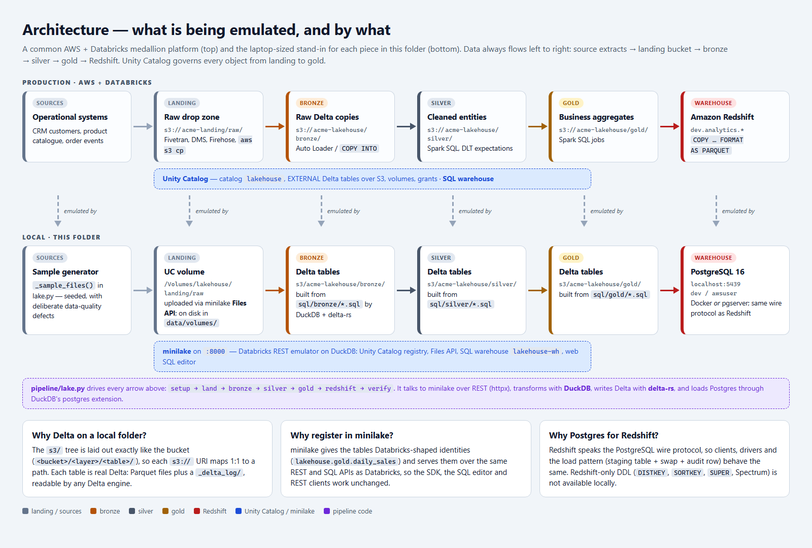
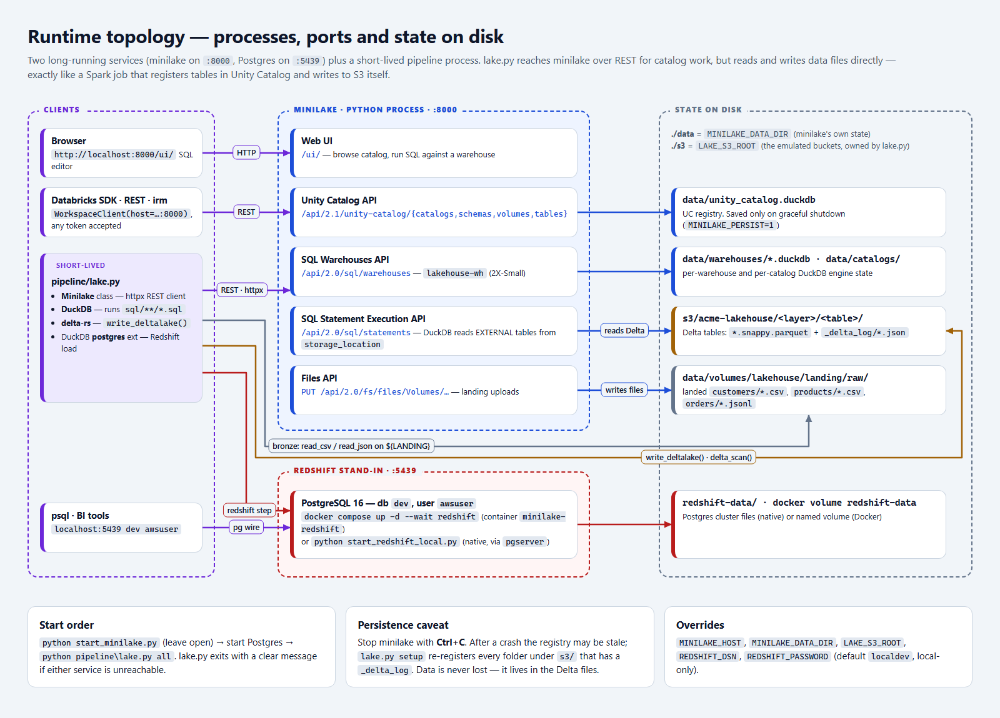
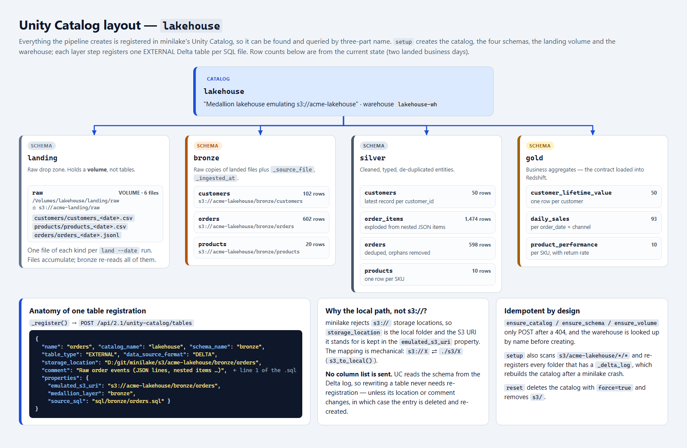
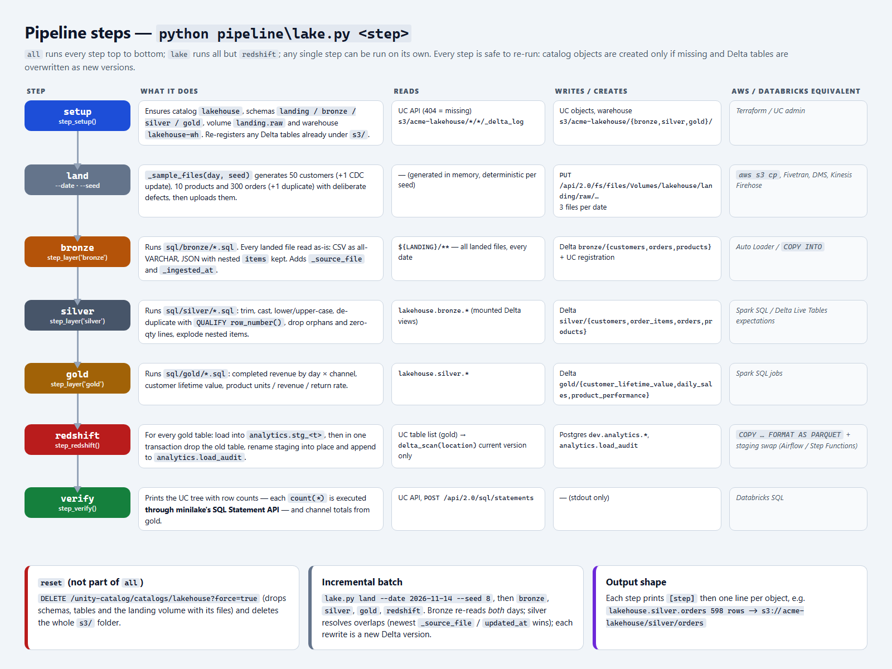
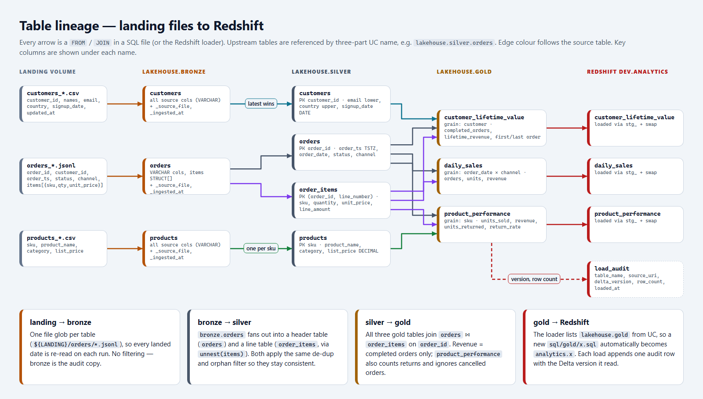
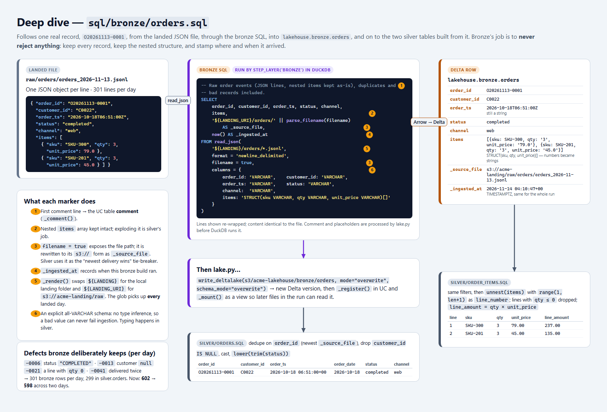
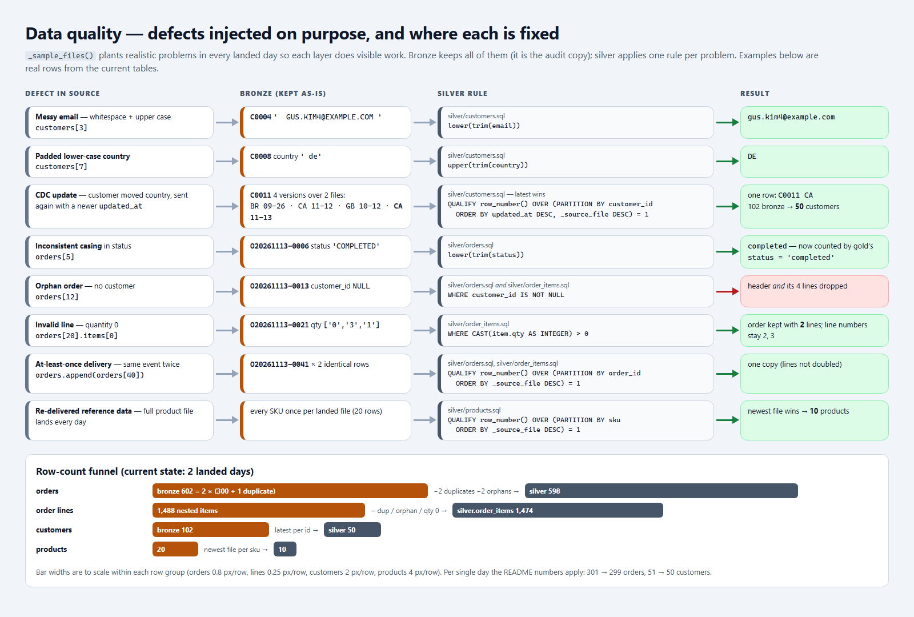
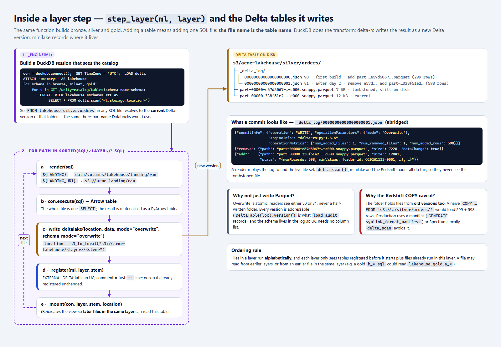
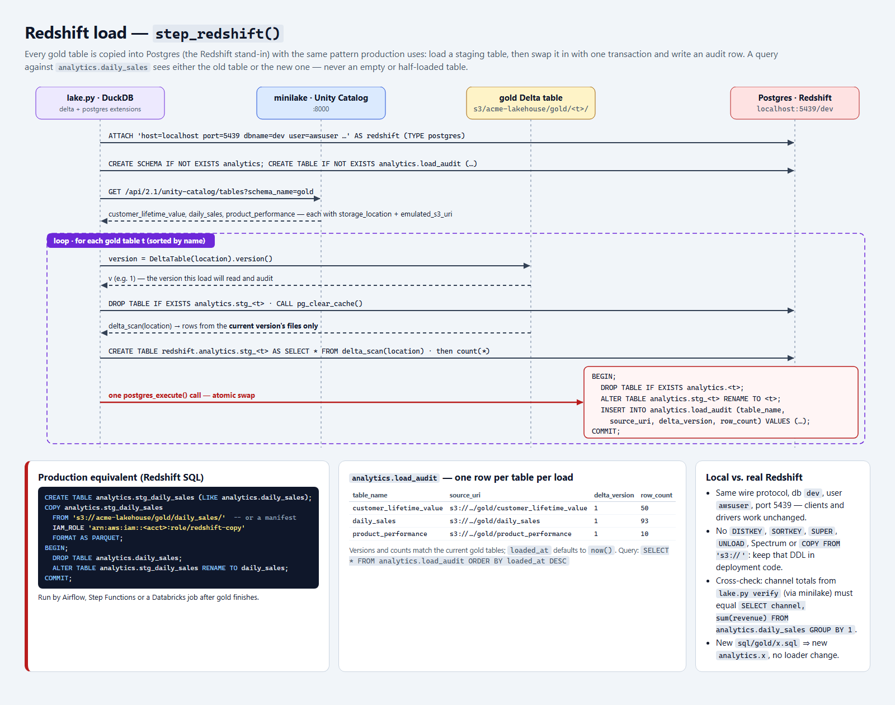

# Components, explained with diagrams

Each diagram is an HTML page in [diagrams/](./diagrams) and is rendered to a PNG in [img/](./img). To
re-render after editing a page, run this from the repo root. It needs Chrome, Chromium or Edge.

```powershell
python docs/diagrams/render.py                   # all diagrams
python docs/diagrams/render.py 06-bronze-orders  # one diagram
```

Row counts and example records in the diagrams come from the tables as they were when the
diagrams were drawn: two business days landed, 2026-11-13 and 2026-11-14.

---

## 1. Architecture: what is emulated, and by what



Data flows left to right: sources → landing → bronze → silver → gold → Redshift. Each production
piece has a local stand-in:

- The S3 buckets become folders under `s3/`. They use the same `<bucket>/<layer>/<table>/` layout, so
  each URI maps to a path one-to-one.
- Databricks and Unity Catalog are replaced by **minilake**.
- Spark jobs are replaced by **DuckDB**, and writes go through **delta-rs**.
- Redshift is replaced by **PostgreSQL** on port 5439.

`pipeline/lake.py` drives every arrow.

## 2. Runtime topology



There are two long-running services and one short-lived process:

- **minilake** (`:8000`) serves the Unity Catalog, Files, SQL Warehouses and SQL Statement APIs, plus a
  web SQL editor. It keeps its own state in `data/`.
- **Postgres** (`:5439`) runs in Docker or natively through `pgserver`.
- **lake.py** uses REST only for catalog work and landing uploads. It reads landing files, and reads
  and writes Delta tables, directly on disk, the way a Spark job writes to S3 and registers tables in
  UC. That is why a stale minilake registry never loses data: `setup` re-registers every folder that
  has a `_delta_log`.

## 3. Unity Catalog layout



There is one catalog, `lakehouse`, with four schemas:

- `landing` holds a **volume**, `raw`, for the source files.
- `bronze`, `silver` and `gold` hold **EXTERNAL Delta** tables.

Each table registration stores:

- the local folder as `storage_location`, because minilake rejects `s3://` locations;
- the S3 URI it stands for in the `emulated_s3_uri` property;
- the first `--` line of its SQL file as the table comment.

No column list is sent. UC reads the schema from the Delta log.

## 4. Pipeline steps



The steps run in this order: `setup → land → bronze → silver → gold → redshift → verify`.

- `all` runs every step.
- `lake` runs every step except `redshift`.
- `reset` is separate: it drops the catalog and deletes `s3/`.

Every step can be re-run safely. Catalog objects are created only when a lookup returns 404, and each
Delta overwrite adds a new version.

## 5. Table lineage



Each arrow is a `FROM` or `JOIN` that uses a three-part UC name. `bronze.orders` splits in silver into
a header table (`orders`) and a line table (`order_items`). All three gold tables join those two
silver tables. The Redshift loader lists `lakehouse.gold` from UC, so a new gold SQL file becomes a
new `analytics.<table>` with no loader change.

## 6. Deep dive: `sql/bronze/orders.sql`



This diagram follows one real record, `O20261113-0001`, from the JSONL file through bronze and into
silver. Bronze **never rejects anything**:

- An explicit all-VARCHAR schema means a bad value can't fail ingestion. For example, JSON `qty: 3`
  becomes the string `'3'`.
- The nested `items` array is kept as it is.
- `filename = true` together with `parse_filename` produces `_source_file`, which silver later uses
  as the "newest delivery wins" tie-breaker.
- `lake.py` replaces the `${LANDING}` and `${LANDING_URI}` placeholders before DuckDB runs the SQL.

## 7. Data quality



`_sample_files()` adds eight kinds of defect to the source data. Bronze keeps every one of them, and
silver fixes each with a single rule:

- `trim`, `lower` and `upper` fix whitespace and casing.
- `QUALIFY row_number()` keeps the latest CDC version and removes duplicate deliveries and
  re-delivered reference data.
- `WHERE customer_id IS NOT NULL` drops orphan orders.
- `qty > 0` drops invalid lines.

In the current tables, 602 bronze orders become 598 silver orders and 102 bronze customers become
50 silver customers.

## 8. Inside a layer step, and Delta tables



`step_layer()` first builds a DuckDB session in which every UC table is a view over
`delta_scan(storage_location)`. Then, for each SQL file in alphabetical order, it:

1. renders the placeholders;
2. runs the SQL into an Arrow table;
3. writes a new Delta version with `write_deltalake(mode="overwrite")`;
4. registers the table in UC;
5. re-mounts the table so later files in the same layer can read it.

The Delta log makes each overwrite atomic and gives every load a version number. Because the folder
also keeps files from older versions, never `COPY` a Delta folder directly.

## 9. Redshift load



For each gold table, the loader:

1. reads the current Delta version;
2. builds `analytics.stg_<t>` with `CREATE TABLE … AS SELECT * FROM delta_scan(…)`;
3. in **one transaction**, drops the old table, renames the staging table into its place and appends
   a row to `analytics.load_audit` (table, S3 URI, Delta version, row count).

Readers never see a partial load. This is the same pattern as Redshift's
`COPY … FORMAT AS PARQUET` followed by a staging-table swap.
