# minilake web UI: user guide

minilake includes a browser UI at **<http://localhost:8000/ui/>** that looks and works like a cut-down
Databricks workspace. This guide covers every page and feature, using screenshots of this project's
`lakehouse` catalog.

For how the data gets there, see [README.md](../README.md) and [COMPONENTS.md](./COMPONENTS.md).

- [Before you start](#before-you-start)
- [Layout and navigation](#layout-and-navigation)
- [Query editor](#query-editor)
- [Saved queries](#saved-queries)
- [Recent queries](#recent-queries)
- [Notebooks](#notebooks)
- [Data catalog](#data-catalog)
- [Files](#files)
- [Workspace](#workspace)
- [Warehouses](#warehouses)
- [Jobs](#jobs)
- [Clusters](#clusters)
- [Secrets](#secrets)
- [Settings](#settings)
- [Tips and known limits](#tips-and-known-limits)

---

## Before you start

```powershell
.\start-minilake.ps1                 # leave running; stop with Ctrl+C
python pipeline\lake.py all          # first time only: builds the lakehouse
```

Then open <http://localhost:8000/ui/>. There is no login: every request runs as
`MiniLake Test User`.

> If the catalog tree says **"No catalogs yet"** even though you have built the lakehouse, minilake
> was stopped without a clean shutdown and its catalog registry was lost. Run
> `python pipeline\lake.py setup`, which re-registers every Delta table under `s3/`, then click the
> refresh icon in the tree.

## Layout and navigation

Every page has three fixed parts:

- **Sidebar** on the left. Its groups are **Query** (Query editor, Saved queries, Recent queries,
  Notebooks), **Data** (Data catalog, Files, Workspace), **Compute** (Warehouses, Jobs, Clusters),
  **Admin** (Secrets) and, at the bottom, **Settings**. The ⊟ button in the header collapses the
  sidebar.
- **Warehouse picker** in the top right. It chooses which SQL warehouse runs your queries.
- **Theme button** (☀) next to the picker. It switches between **Light**, **Dark** and **System**.

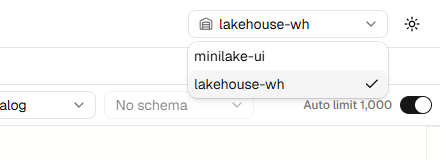

`minilake-ui` is created automatically for the UI. `lakehouse-wh` is created by
`lake.py setup`. Every warehouse runs on the same DuckDB engine, so it doesn't matter which one you
pick.

---

## Query editor

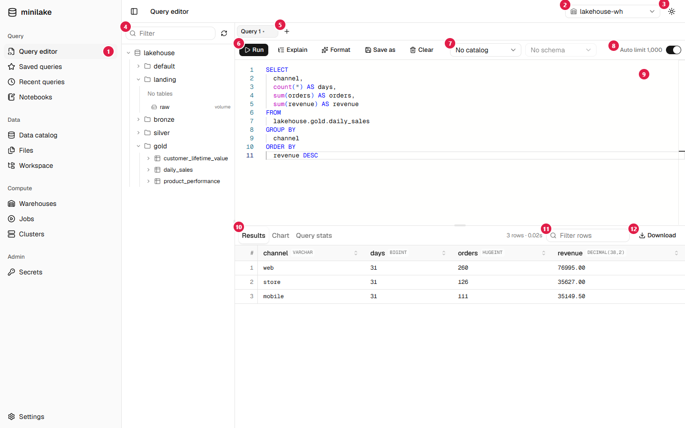

| # | Control | What it does |
|---|---|---|
| 1 | Sidebar | Moves between pages |
| 2 | Warehouse | Chooses the warehouse that runs the query |
| 3 | Theme | Switches between Light, Dark and System |
| 4 | Catalog filter + ⟳ | Filters the catalog tree; ⟳ reloads it from Unity Catalog |
| 5 | Query tabs, **+** | Each tab is an independent query. A dot (•) means unsaved changes |
| 6 | **Run** | Runs the query. Shortcut: **Ctrl/Cmd + Enter**. If text is selected, only the selection runs |
| 7 | Catalog / Schema | Sets the session's current catalog and schema |
| 8 | Auto limit | Wraps bare `SELECT`s in `LIMIT 1000` |
| 9 | Editor | Monaco SQL editor with syntax highlighting and autocomplete |
| 10 | Results / Chart / Query stats | Three views of the last result |
| 11 | Filter rows | Filters the result grid on the client side |
| 12 | Download | Exports the result as CSV or JSON |

### Toolbar

- **Run** runs the editor contents. If text is selected, only the selection runs.
- **Explain** runs `EXPLAIN` on the query and shows DuckDB's physical plan (see
  [Explain](#explain)).
- **Format** pretty-prints the SQL: keywords in upper case, one clause per line.
- **Save as** saves the tab under its name, for example *Query 2*. After that the button reads
  **Save**. To rename a saved query, use [Saved queries](#saved-queries).
- **Clear** empties the editor.

### Browsing the catalog from the editor

The tree on the left shows **catalog → schema → table → column**. Volumes are listed too, for
example `landing/raw`. Click a table's chevron to see its columns and their types. Right-click a
table for more actions:

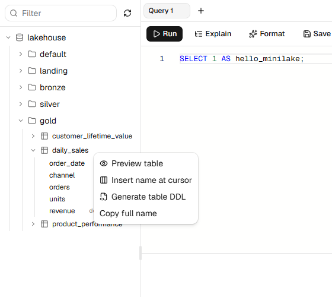

- **Preview table** opens a new tab containing `SELECT * FROM <table> LIMIT 100`.
- **Insert name at cursor** inserts the full three-part name at the cursor. Double-clicking a table
  does the same.
- **Generate table DDL** shows the `CREATE TABLE … USING DELTA LOCATION …` statement for the table.
- **Copy full name** copies `lakehouse.gold.daily_sales` to the clipboard.

### Autocomplete

As you type, the editor suggests catalogs, schemas, tables and columns from Unity Catalog. Type a
`.` after a schema to list its tables:

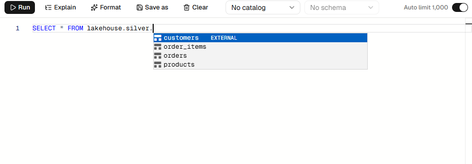

To turn autocomplete off, go to [Settings](#settings).

### Default catalog and schema

The **Catalog** and **Schema** dropdowns set the session's current namespace. That is what
`current_database()` and `current_schema()` return:

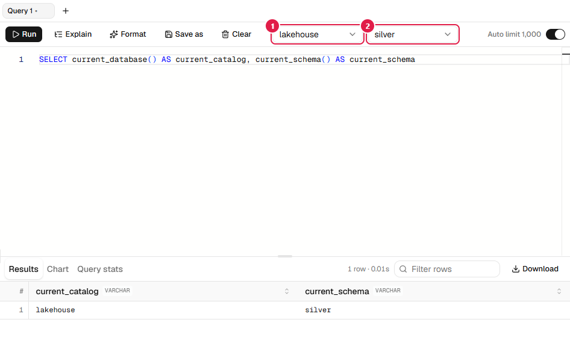

> In this project, always use **three-part names** such as `lakehouse.silver.orders`. The tables
> are EXTERNAL Delta tables, and minilake does not resolve unqualified names like `orders` against
> them, even when the Schema dropdown is set. That query fails with *"Table with name orders does
> not exist"*.

### Results grid

- Each column header shows the column's **name and type**. Click a header to sort; click again to
  reverse the order.
- **Filter rows** keeps only the rows that contain the text, in any column. The row count updates as
  you type.
- The status line shows the row count and how long the query took, for example `51 rows · 0.02s`.

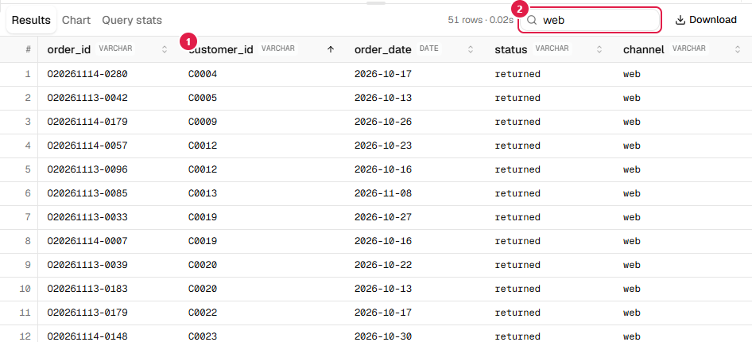

*In this example, the returned orders are sorted by `customer_id` (1) and filtered to `web` (2).*

### Chart

The **Chart** tab draws the current result as a chart. Choose a **Chart** type (Bar, Line or
Area), a **Category** column for the x-axis, and one or more **Values** columns. Numeric columns
are picked automatically.

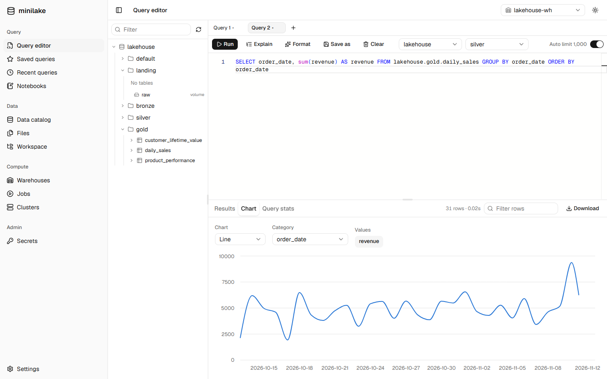

### Query stats

**Query stats** shows the statement's status, elapsed time, row and column counts, statement ID,
start and end times, and result format. **Statement as executed** shows the SQL the warehouse
actually ran, including the auto-limit wrapper:

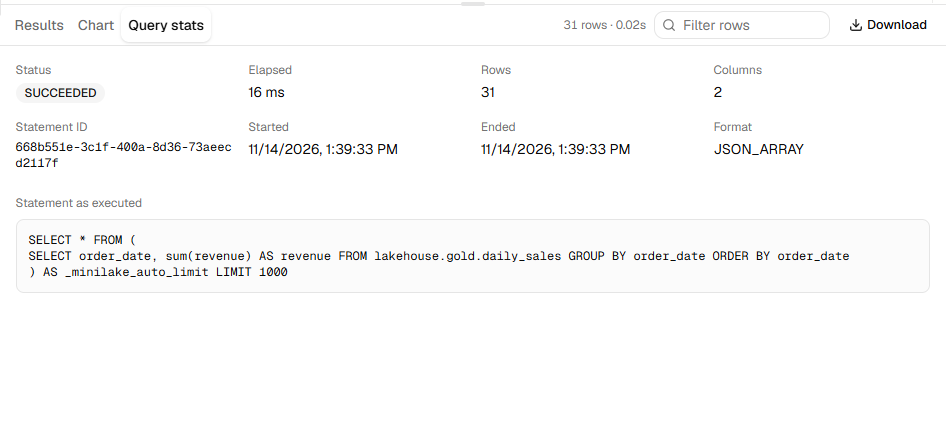

### Explain

**Explain**, or running an `EXPLAIN …` statement, returns DuckDB's physical plan as a single
`physical_plan` row. The plan includes the `delta_scan` that reads the table's Delta folder:

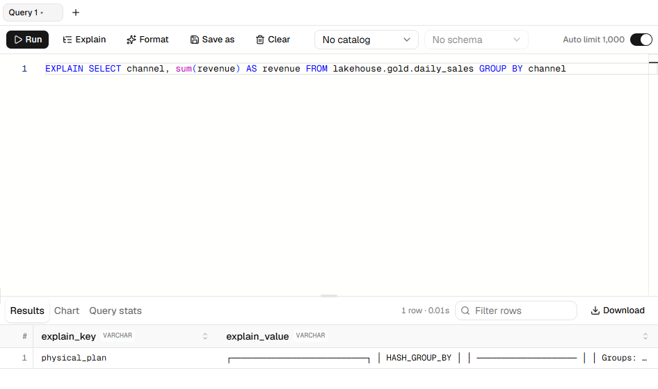

The plan is drawn as box art and doesn't fit in the grid cell. To read it all, use **Download → JSON**
or **CSV**.

### Download

**Download** saves every row the query returned as **CSV** or **JSON**. **Filter rows** does not
limit the export:

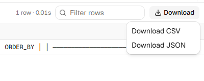

### Errors

A failed query shows DuckDB's message, with a caret under the problem and suggested fixes:

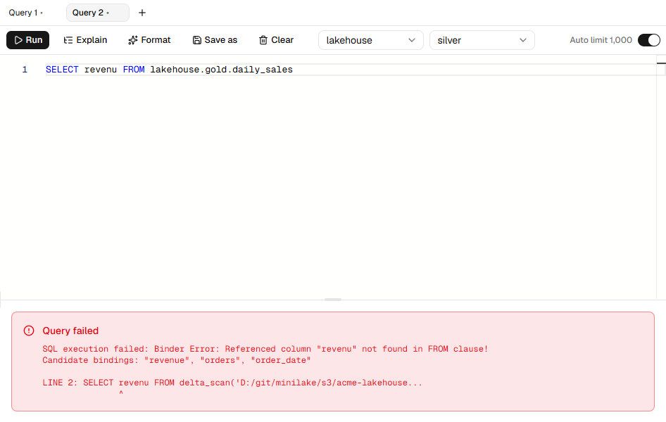

The table name in the error is the internal `delta_scan('…')` path, not the UC name. Failed
queries also appear in [Recent queries](#recent-queries).

### Saving a query

Click **Save as**. A toast confirms the save, and from then on the button saves changes in place:

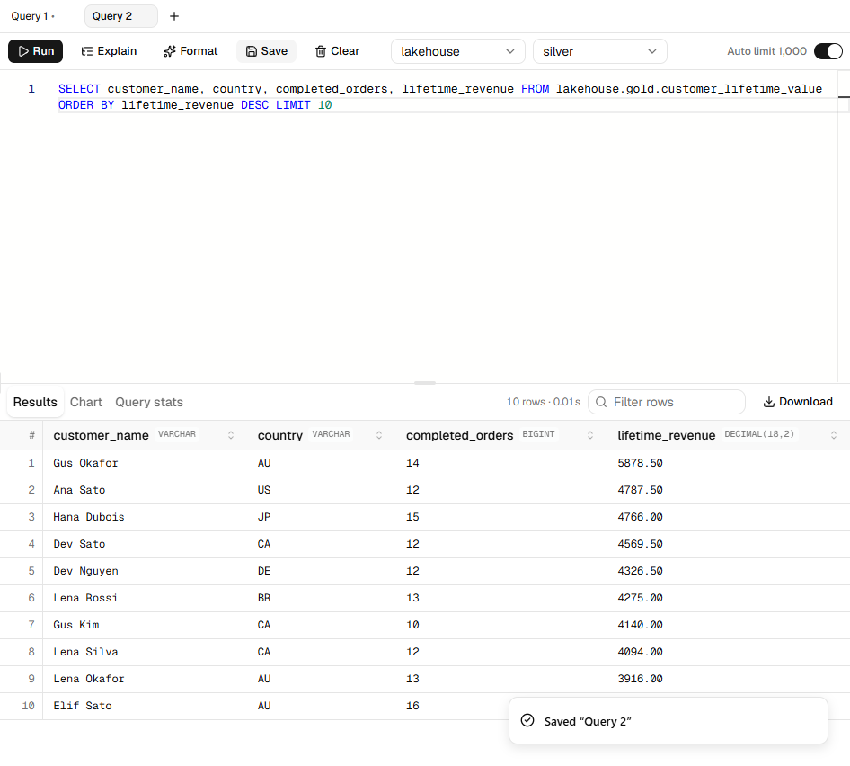

---

## Saved queries

All saved queries, with their name, SQL, the namespace they were saved with, and the time they were
last updated.

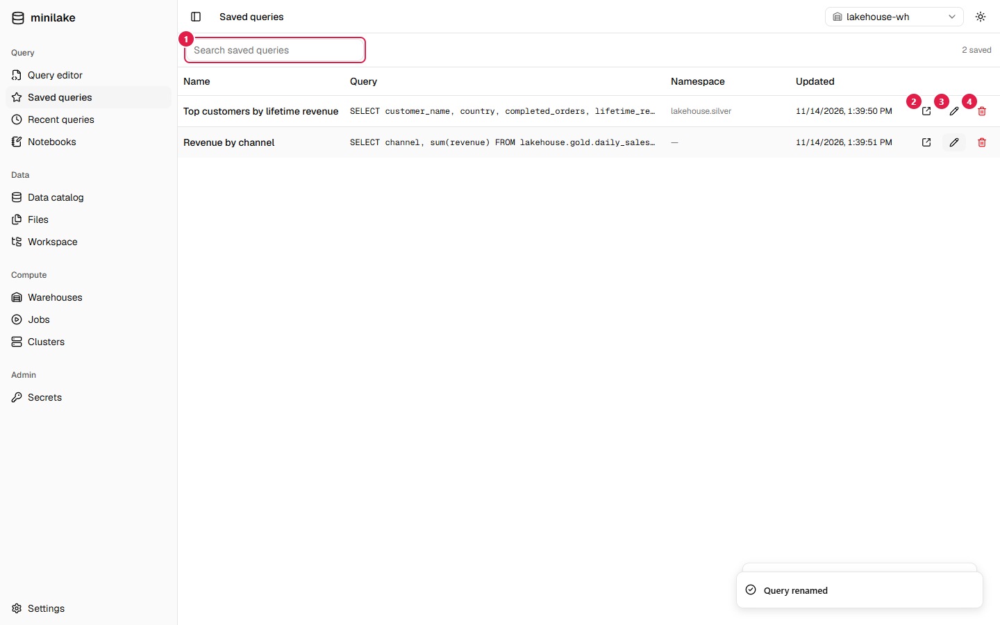

1. **Search** by name or SQL text.
2. **Open in editor** opens the query in a new editor tab.
3. **Rename** asks for a new name.
4. **Delete** removes the query.

Saved queries are stored on the minilake server, not in the browser, so they survive a browser
refresh and are shared by every browser that opens the UI.

## Recent queries

Every statement any client has run against minilake: the UI, `lake.py verify`, the Databricks SDK
and REST calls.

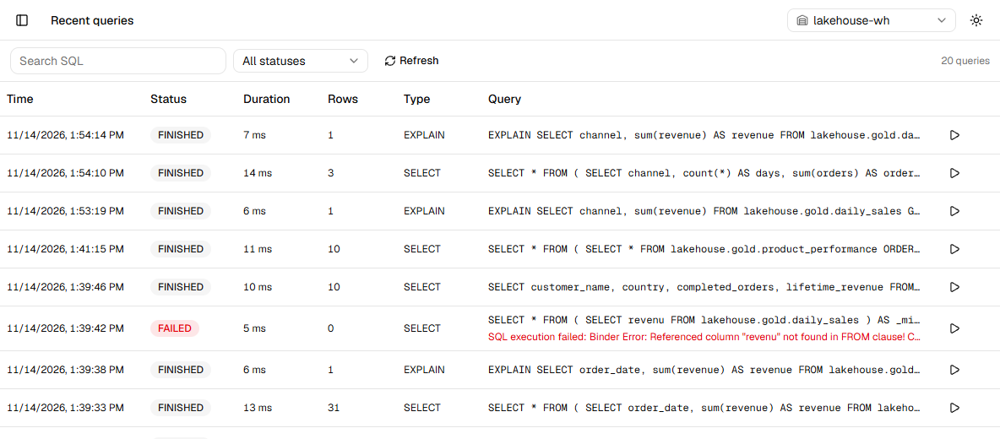

- Each row shows the time, status, duration, row count and statement type (`SELECT`, `EXPLAIN`, …).
  Failed queries also show their error message.
- Use **Search SQL** and the **status** filter (FINISHED / FAILED / CANCELED) to narrow the list.
  Click **Refresh** to pick up new statements.
- **▷ Open in editor** loads the statement into a new tab.

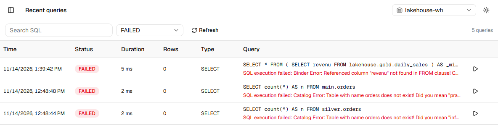

The SQL shown is the statement **as executed**, so it includes the
`SELECT * FROM (…) AS _minilake_auto_limit LIMIT 1000` wrapper.

## Notebooks

An embedded **JupyterLab**, served by minilake under `/jupyter/` so it can sit inside the UI. It
opens in `data\notebooks`, which starts with two example notebooks from minilake:
`minilake_quickstart.ipynb` and `minilake_delta_optimize_vacuum.ipynb`.

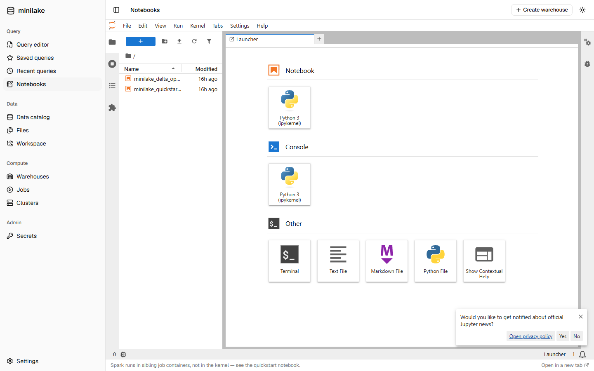

- The launcher can create **Python 3 notebooks**, a **console**, a **terminal**, and text, Markdown
  or Python files. They are saved in `data\notebooks`.
- **Open in a new tab** (bottom right) opens JupyterLab full-screen at
  <http://localhost:8000/jupyter/lab>.
- The kernel runs in minilake's own Python environment, so `duckdb`, `deltalake`, `httpx` and
  `pyarrow` are already available. For example, you can read gold tables directly with
  `duckdb.sql("SELECT * FROM delta_scan('../../s3/acme-lakehouse/gold/daily_sales')")`.
- As the footer says, **Spark does not run in the kernel**. Spark code runs in job containers, which
  need Docker; see the quickstart notebook.

Notebooks need the `notebook` extra, which `requirements.txt` installs. `start-minilake.ps1` turns
them on by default. To start without them, use `.\start-minilake.ps1 -NoNotebook`. In that case,
or if `jupyterlab` is missing, this page shows **"Notebooks are turned off"**.

---

## Data catalog

The full-page Unity Catalog browser. Select a table to see its details:

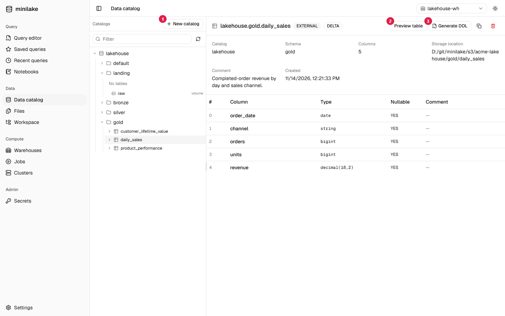

The header shows the table's full name and badges for its **type** (`EXTERNAL`) and **format**
(`DELTA`). The details panel shows the catalog, schema, column count, **storage location** (the
local Delta folder), the comment from the first line of the table's SQL file, the creation time,
and the column list with types and nullability.

| # | Action | Result |
|---|---|---|
| 1 | **New catalog** | Asks for a name and an optional comment, then creates the catalog |
| 2 | **Preview table** | Opens the editor with `SELECT * FROM <table> LIMIT 100` |
| 3 | **Generate DDL** | Shows the `CREATE TABLE` statement, with a **Copy** button |
| – | ⧉ / 🗑 | **Copy full name** / **Drop table** |

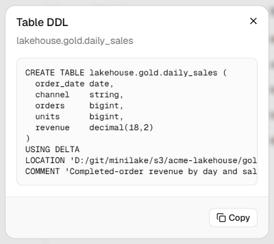

> **Drop table** removes the table from Unity Catalog. This project's Delta files live under `s3/`,
> outside minilake's data folder, so you can register the table again with `lake.py setup`, or by
> rebuilding its layer with `lake.py <layer>`.

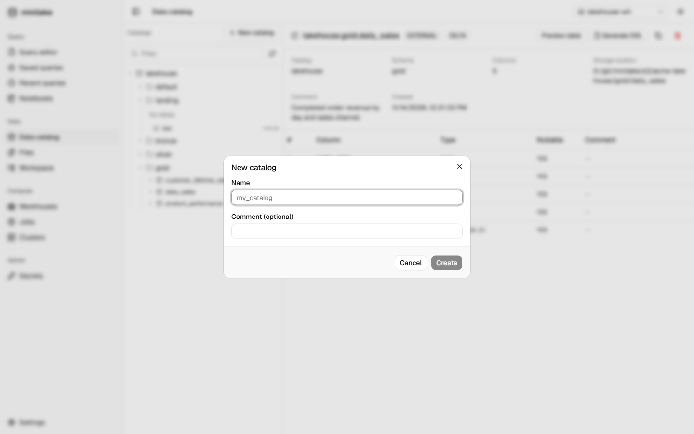

## Files

A browser for minilake's **DBFS** file store, the `/api/2.0/fs` API. Click a folder to open it, and
use the breadcrumb to go back up.

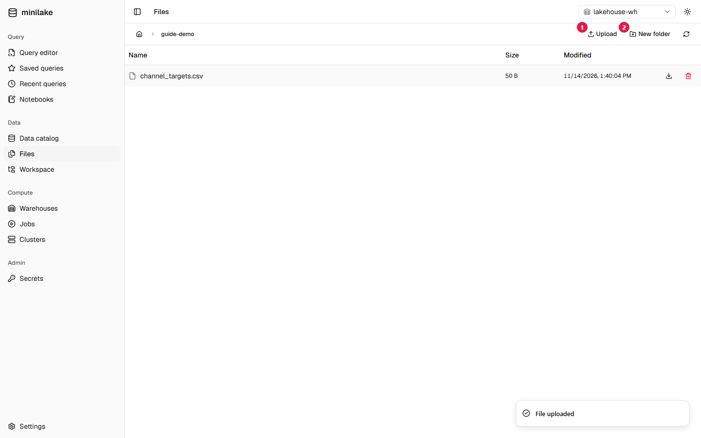

1. **Upload** sends a file from your computer to the current folder.
2. **New folder** asks for a name and creates the folder.

Each file has **⤓ download** and **🗑 delete** buttons, and ⟳ reloads the list.

> The landing **volume** (`/Volumes/lakehouse/landing/raw`) is not shown here. Browse it from the
> Data catalog tree, or list it through the API:
> `irm http://localhost:8000/api/2.0/fs/directories/Volumes/lakehouse/landing/raw`.

## Workspace

The workspace tree under `/Workspace`, where notebooks and job source files live. You can browse it,
create folders with **New folder**, and delete objects.

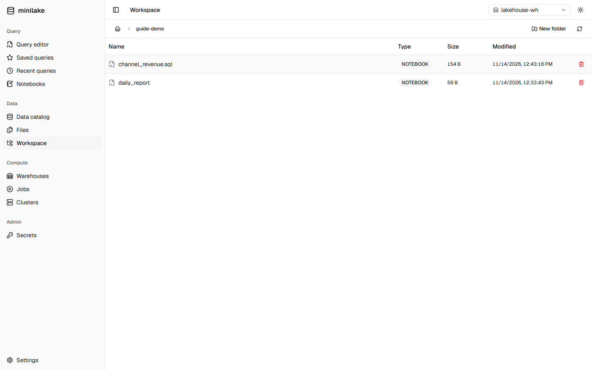

The UI has no upload button. Add files through the Workspace API instead; this minilake supports
`format` `SOURCE` or `AUTO`:

```powershell
$src = "-- Revenue by channel`nSELECT channel, sum(revenue) AS revenue FROM lakehouse.gold.daily_sales GROUP BY channel;"
$body = @{ path = '/Workspace/guide-demo/channel_revenue.sql'; format = 'AUTO'; overwrite = $true
           content = [Convert]::ToBase64String([Text.Encoding]::UTF8.GetBytes($src)) } | ConvertTo-Json
irm -Method Post http://localhost:8000/api/2.0/workspace/import -Body $body -ContentType 'application/json'
```

Every imported object is listed with type `NOTEBOOK`, whatever its extension. A `.sql` file
imported this way still works as a **SQL file** job task.

---

## Warehouses

All SQL warehouses, with their ID, state, size and creation time. Each row has **Stop / Start** and
**Delete** buttons.

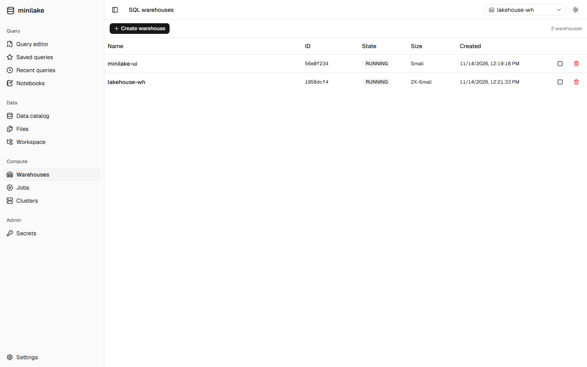

**Create warehouse** asks for a name and a cluster size. minilake records the size but runs every
warehouse on the same DuckDB engine, so size has no effect on performance.

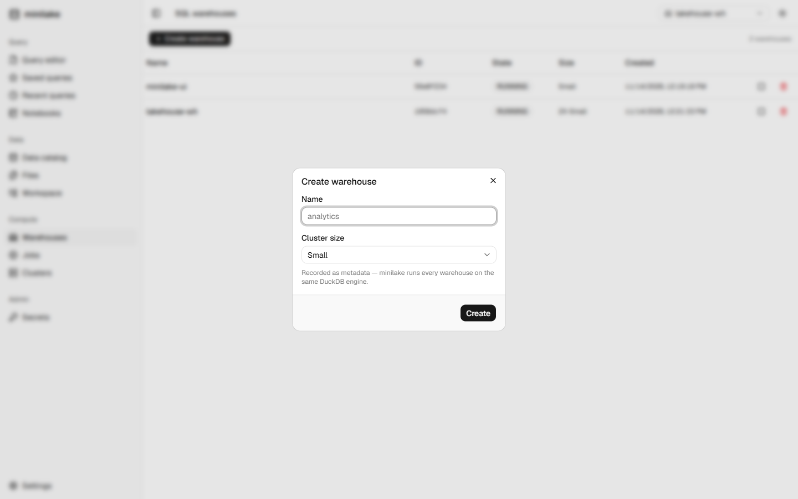

> Don't delete `lakehouse-wh`. `lake.py verify` looks it up by name, although it recreates it if it
> is missing.

## Jobs

Multi-task jobs that run in order; each task depends on the one above it. The page lists **Jobs**
at the top and their **Runs** underneath.

Click **New job** (or ✎ to edit an existing job), then for each task fill in:

- a **task key**;
- a **type**:
  - **Notebook**: a `.py` notebook in the workspace, run with `spark-submit`.
  - **Python file**: a `.py` file, run with `spark-submit`.
  - **SQL file**: a `.sql` file in the workspace, run on **minilake's own engine** against the
    warehouse you choose.
- the workspace **path** of the notebook or file;
- for SQL files, the **warehouse**.

Use **Add task** to add more steps.

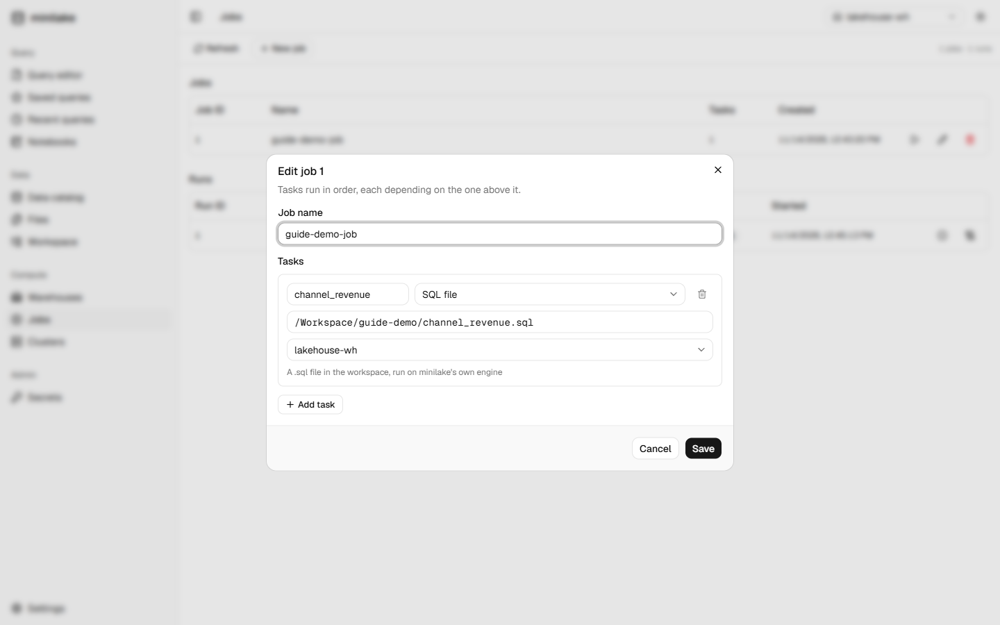

Each job row has **▷ Run now**, **✎ Edit** and **🗑 Delete**. Each run shows its lifecycle
(`PENDING` → `RUNNING` → `TERMINATED`) and result (`SUCCESS` / `FAILED`). Click **Refresh** to
update the list.

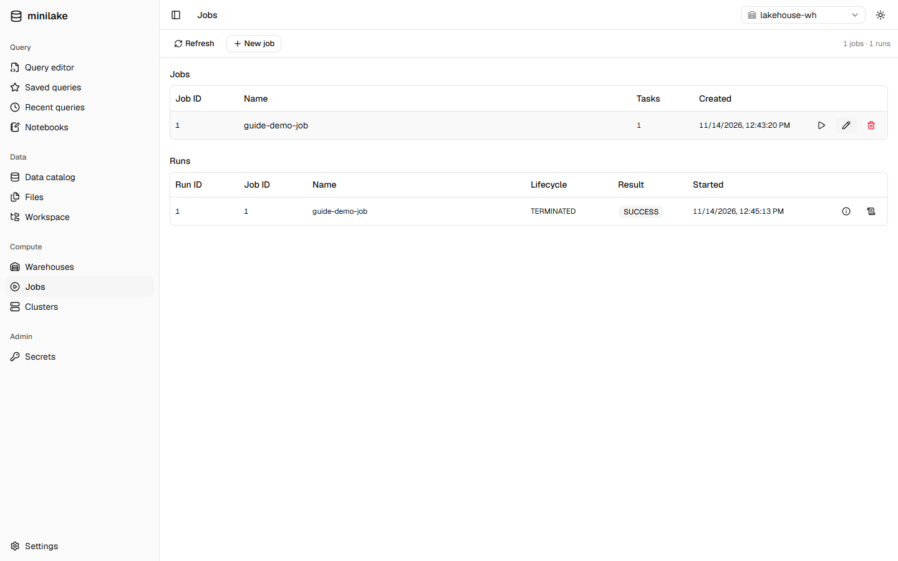

Each run has two buttons:

**ⓘ Run details** shows the run's timing and each task's lifecycle, result and duration:

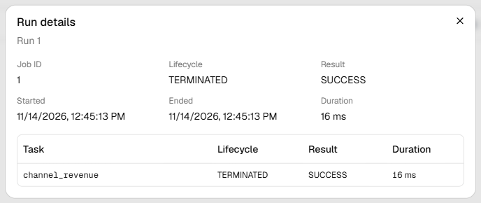

**View output** shows what the run returned. For a SQL task, that is the result's columns and rows:

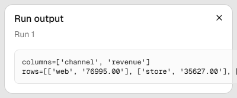

> **SQL file** tasks work without Docker. **Notebook** and **Python file** tasks run `spark-submit`
> in their own containers, so they need Docker Desktop running.

## Clusters

Create, restart, terminate and remove all-purpose clusters. You can choose the Spark version,
13.3 LTS or 14.3 LTS. As the page says, **clusters are only a state machine**: they record
`RUNNING` / `TERMINATED` but run no Spark. They exist so Databricks clients that expect clusters
keep working.

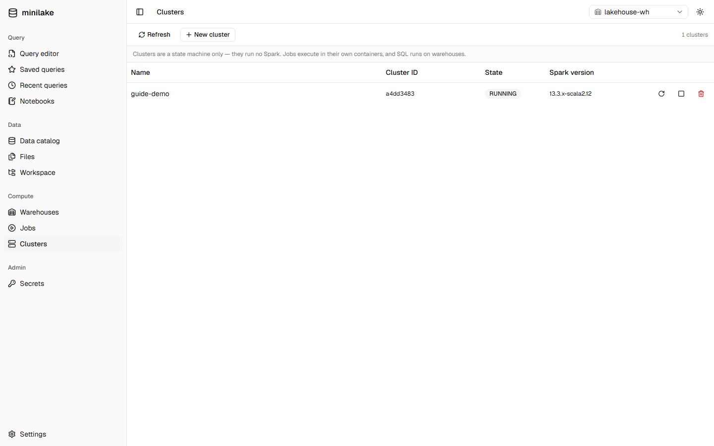

## Secrets

Secret **scopes** and the **keys** in them. Values are **write-only**: neither the UI nor the API
can read them back. Jobs resolve them at run time from `{{secrets/<scope>/<key>}}` references in a
task's `spark_env_vars`.

1. Click **New** in the Scopes panel and enter a scope name.
2. Select the scope, click **New secret**, and enter a key and a value:

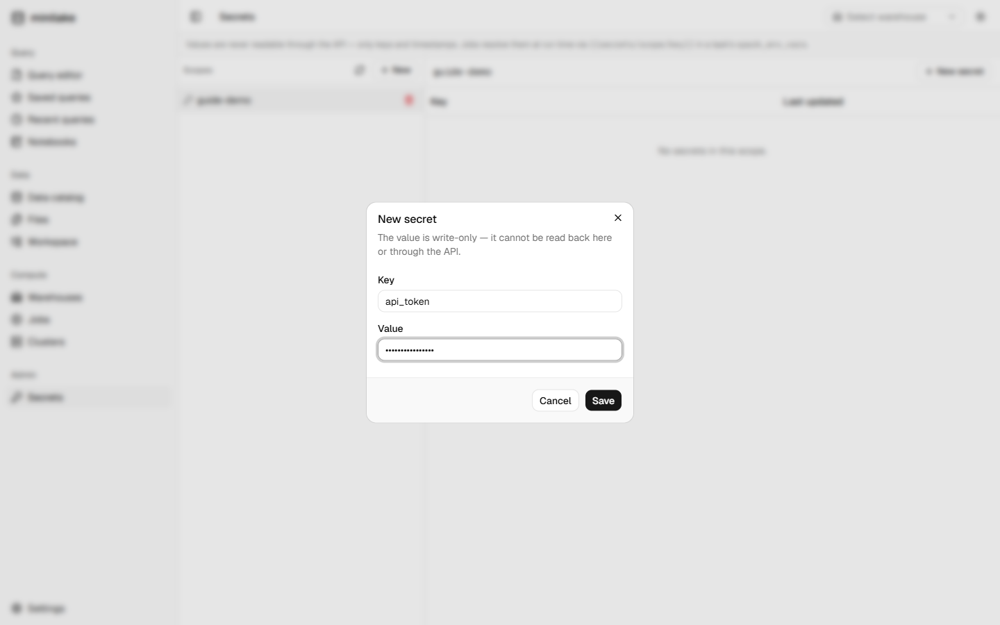

Each key shows when it was last updated, with **Replace** (set a new value) and **🗑** (delete)
buttons. The 🗑 next to a scope deletes the scope and every key in it.

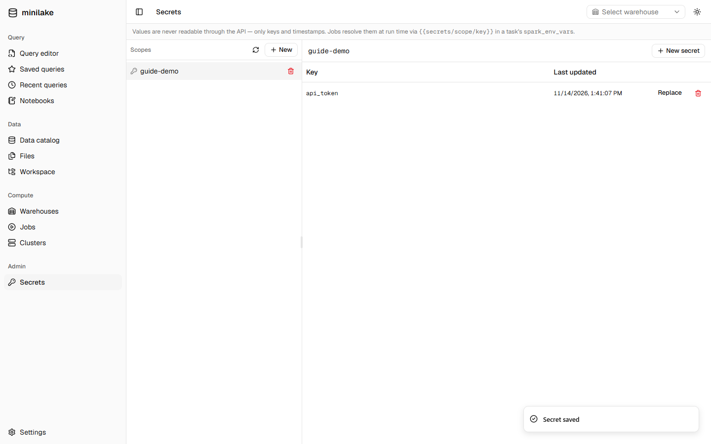

> minilake is a local emulator with no authentication. Use it only for development placeholders,
> never for real credentials.

## Settings

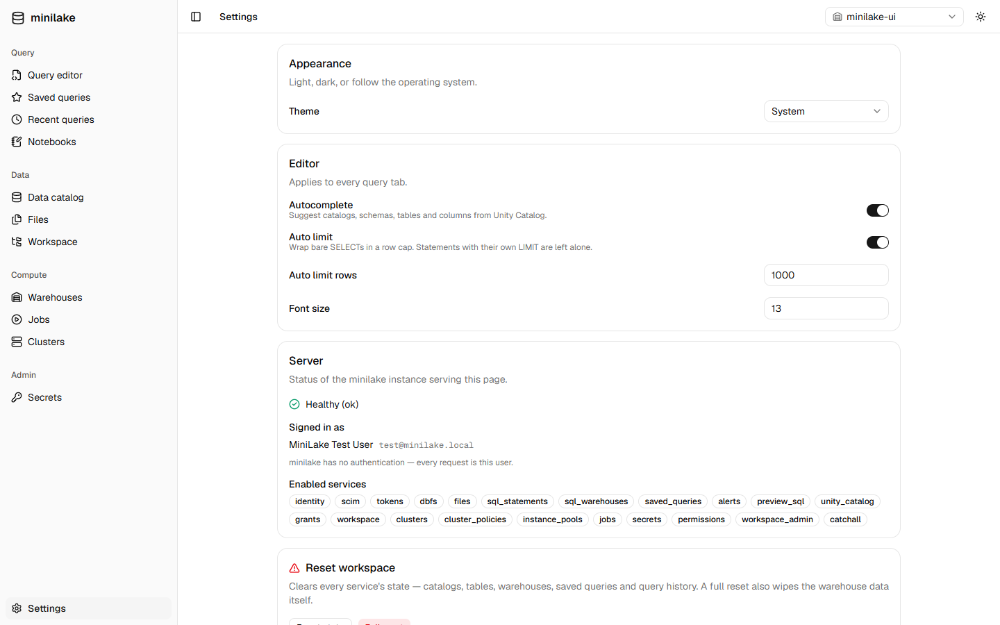

- **Appearance → Theme**: Light, Dark or System. The ☀ button in the header changes the same
  setting.
- **Editor**, which applies to every query tab:
  - **Autocomplete** turns Unity Catalog suggestions on or off.
  - **Auto limit** wraps bare `SELECT`s in a row cap. Statements with their own `LIMIT` are left
    alone.
  - **Auto limit rows** sets the cap; the default is 1000.
  - **Font size** sets the editor font size.
- **Server** shows minilake's health, the built-in user (`test@minilake.local`), and the API
  services this instance provides (Unity Catalog, SQL Statements, Warehouses, Files/DBFS,
  Workspace, Jobs, Clusters, Secrets, and others).
- **Reset workspace**:

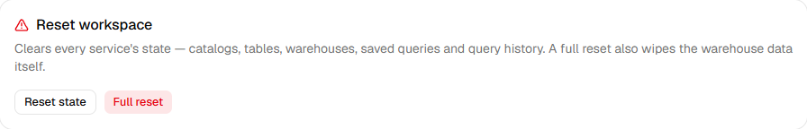

| Button | Effect |
|---|---|
| **Reset state** | Clears catalogs, tables, warehouses, saved queries and query history |
| **Full reset** | Does the same, and also deletes the warehouse data |

Neither button touches this project's Delta files under `s3/` or the landed files. Afterwards, run
`python pipeline\lake.py setup` to recreate the catalog and register the tables again.

### Dark theme

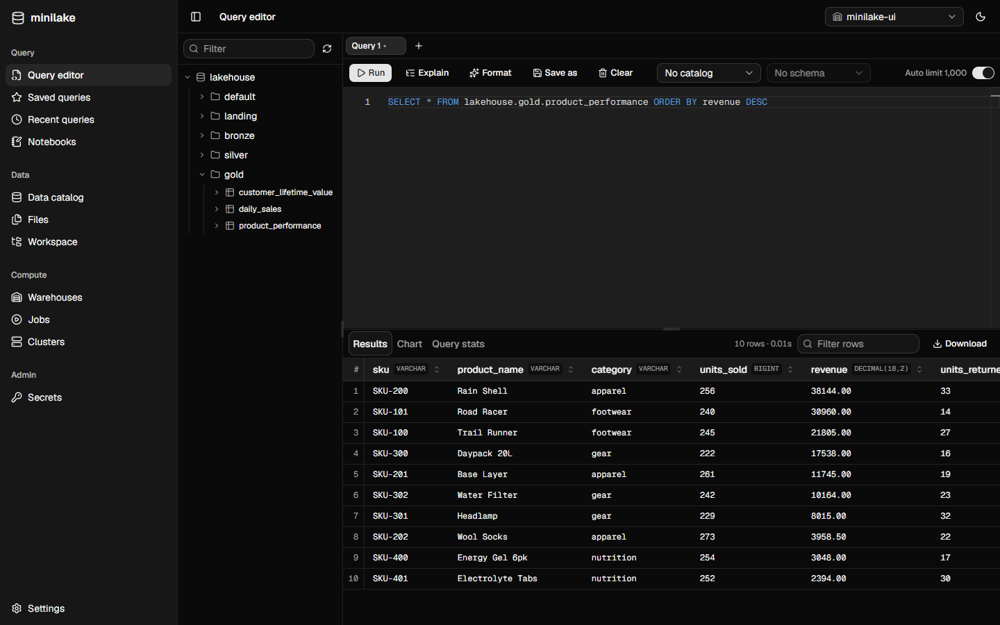

---

## Tips and known limits

| Topic | Notes |
|---|---|
| Table names | Always use three-part names (`lakehouse.gold.daily_sales`). Unqualified names don't resolve against EXTERNAL tables. |
| Changing data | Treat the UI as **read-only** for `lakehouse` tables. `INSERT` / `UPDATE` / `MERGE` against EXTERNAL Delta tables needs Spark in Docker. Rebuild tables with `lake.py` instead. |
| Persistence | Catalog objects, saved queries and history are saved only when minilake shuts down cleanly (**Ctrl+C**). After a crash, run `lake.py setup`. |
| Auto limit | The result grid shows at most 1000 rows unless you add your own `LIMIT` or change the cap in Settings. **Download** exports only the rows that were returned. |
| Many warehouses | All warehouses share one engine. Pick any of them. |
| Same data elsewhere | The queries you run here also work through the Databricks SDK and the SQL Statement API. See *Using the lakehouse like Databricks* in the README. |

### Demo objects in the screenshots

The screenshots were taken after creating a few example objects. They are safe to delete from their
pages:

| Page | Objects |
|---|---|
| Files | `guide-demo/channel_targets.csv` |
| Workspace | `guide-demo/` containing `daily_report` and `channel_revenue.sql` |
| Jobs | `guide-demo-job` |
| Clusters | `guide-demo` |
| Secrets | scope `guide-demo` |
| Saved queries | *Top customers by lifetime revenue*, *Revenue by channel* |
